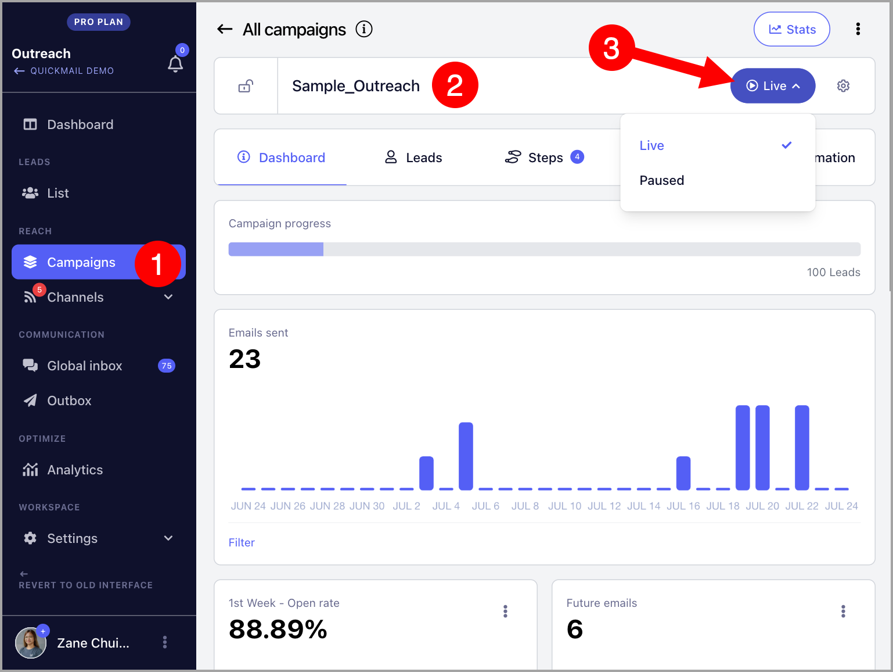
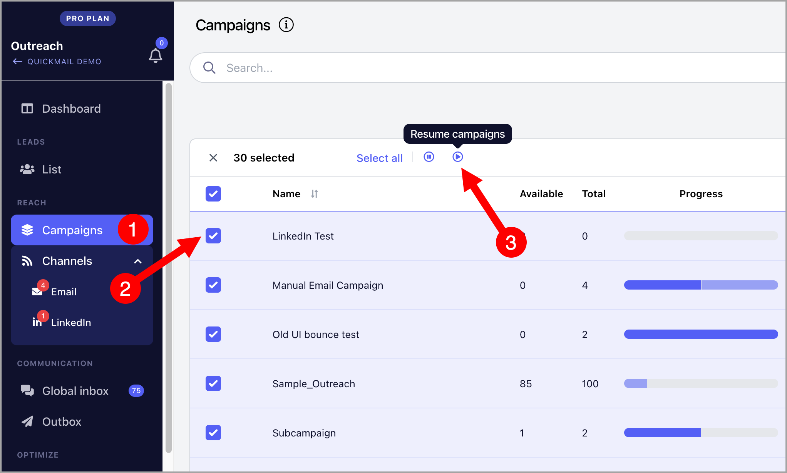

# Pausing and Unpausing Campaigns

There are two ways to pause and unpause campaigns: **Manually** and **in Bulk**.

**In this article:**

- Manual

- In bulk

## Manual

To manually pause or resume a campaign, go to the campaign → click the **Live** or **Pause** button.

## In Bulk

To pause or resume multiple campaigns at the same time, go to **Campaigns** → select your preferred campaigns → click the **Pause** or **Resume** button.

## What happens when I pause and unpause a campaign?

When a campaign is paused, no emails are sent and leads won’t move to the next step. Once the campaign is unpaused, leads continue from where they left off.

However, if a lead is on a wait step, the wait days keep counting even while the campaign is paused.

For example, say a lead is on a 3 day wait step, and you pause the campaign on day 1 of that wait. If you unpause the campaign 3 days later, the lead will move to the next email step right away, since the 3 day wait has already passed.
